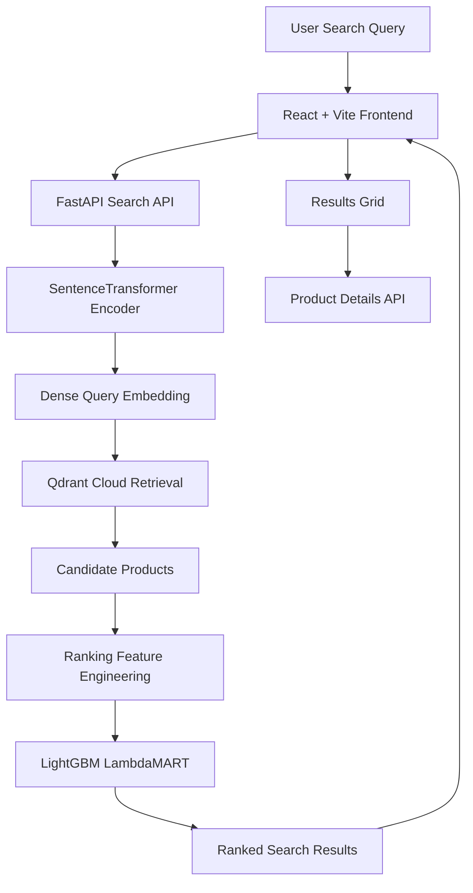

<div align="center">

# RankEngine

### Intelligent Product Search & Machine-Learning Ranking

Dense bi-encoder retrieval, LightGBM LambdaMART reranking, a FastAPI backend and a React web application, combined in one end-to-end search system.


[**Live Demo**](https://rankengine-frontend.vercel.app/) ·
[**Source Code**](https://github.com/vaishnavi-c12488/RankEngine) ·
[**API Reference**](#backend-api-reference) ·
[**Troubleshooting**](#troubleshooting)

</div>

> **Project status: functional demonstration.** The frontend is deployed on Vercel. The backend currently runs on the developer's laptop and is exposed through a temporary Cloudflare Quick Tunnel, so search is available only while that backend is running. See [Demo availability](#demo-availability) and [Deployment](#deployment).

---

## Table of Contents

- [Overview](#overview)
- [Live Demo](#live-demo)
- [Key Features](#key-features)
- [System Architecture](#system-architecture)
- [How Search Works](#how-search-works)
- [Design Decisions](#design-decisions)
- [Technology Stack](#technology-stack)
- [Dataset and Product Index](#dataset-and-product-index)
- [Project Structure](#project-structure)
- [Getting Started](#getting-started)
- [Configuration](#configuration)
- [Backend API Reference](#backend-api-reference)
- [Frontend Architecture](#frontend-architecture)
- [Testing and Validation](#testing-and-validation)
- [Deployment](#deployment)
- [Troubleshooting](#troubleshooting)
- [Security Notes](#security-notes)
- [Current Limitations](#current-limitations)
- [Roadmap](#roadmap)
- [Acknowledgements and References](#acknowledgements-and-references)
- [Author](#author)

---

## Overview

Keyword search can return products that share words with a query without ordering them by how relevant they are. RankEngine addresses this with a two-stage pipeline:

1. **Dense retrieval.** A SentenceTransformer encoder turns the query into a vector, and Qdrant returns the nearest product vectors as candidates. This stage is fast and favors recall.
2. **Learning-to-Rank.** A LightGBM LambdaMART model scores each candidate using engineered query-product features and reorders them. This stage favors precision at the top of the list.

A FastAPI service orchestrates both stages and a React website presents the ranked results, including a product detail page for every result.

The project brings together information retrieval, vector search, feature engineering, machine learning, API design and frontend engineering in a single application.

## Live Demo

| Resource | Link |
|---|---|
| Live website | [rankengine-frontend.vercel.app](https://rankengine-frontend.vercel.app/) |
| Source repository | [github.com/vaishnavi-c12488/RankEngine](https://github.com/vaishnavi-c12488/RankEngine) |
| Frontend hosting | [Vercel](https://vercel.com/) |
| Vector database | [Qdrant Cloud](https://cloud.qdrant.io/) |
| Backend framework | [FastAPI](https://fastapi.tiangolo.com/) |
| Embedding model | [all-MiniLM-L6-v2](https://huggingface.co/sentence-transformers/all-MiniLM-L6-v2) |
| Ranking framework | [LightGBM](https://lightgbm.readthedocs.io/) |
| Tunnel service | [Cloudflare Tunnel](https://developers.cloudflare.com/cloudflare-one/connections/connect-networks/) |

### Demo availability

The website itself is always reachable, but **search works only when the backend is running**. The backend does not yet have permanent hosting: it runs locally and is published through a temporary tunnel URL. If a search shows a "cannot reach the service" message, the backend is most likely offline. See [Troubleshooting](#troubleshooting).

<!--
  SCREENSHOTS: add images to docs/images/ and uncomment the block below.

  | Home | Search results | Product details |
  |---|---|---|
  |  |  |  |
-->

## Key Features

**Search and ranking**
- **Semantic retrieval:** queries are encoded with SentenceTransformers, so matching is based on meaning rather than exact keywords.
- **Vector similarity search:** candidates come from Qdrant Cloud with a marketplace filter.
- **Machine-learning reranking:** a trained LightGBM LambdaMART model reorders the candidates.
- **Marketplace selection:** United States, Japan and Spain (`us`, `jp`, `es`).

**Web application**
- **Results grid:** responsive layout with loading skeletons, empty states and friendly error states.
- **Sorting and filtering:** sort by RankEngine relevance, product title or retrieval score, and filter by brand.
- **Product detail pages:** each product opens by its stable product ID and marketplace, never by re-running a search.
- **Search-state preservation:** query, marketplace, sort and filter live in the URL, so refresh and the browser Back button behave predictably.
- **Search suggestions and history:** keyboard-accessible suggestions and per-session recent searches.
- **Safe text rendering:** catalog HTML is converted to plain text rather than injected into the page.
- **Honest data handling:** attributes missing from the catalog are omitted or labelled "Not available", never invented.

**Engineering**
- **REST API:** search, health, index metadata and product-detail endpoints with request validation.
- **Test coverage:** backend API tests and frontend component and flow tests.

## System Architecture



### Component responsibilities

| Component | Responsibility |
|---|---|
| React frontend | Search interface, marketplace selection, result cards, filters, sorting and product details |
| FastAPI | Request validation, endpoints, search orchestration and response formatting |
| SentenceTransformers | Converts text queries into dense vector embeddings |
| Qdrant Cloud | Stores product vectors and payloads; retrieves candidates; serves product lookups |
| Feature engineering | Builds the ranking features the trained model expects |
| LightGBM LambdaMART | Predicts a relevance score for each candidate and reranks them |
| Cloudflare Quick Tunnel | Exposes the locally running backend through a temporary public HTTPS URL |

## How Search Works

1. **Query input.** The user enters a query such as `wireless headphones` and chooses a marketplace.
2. **Query encoding.** The backend encodes the query with `sentence-transformers/all-MiniLM-L6-v2` into a normalized dense vector.
3. **Candidate retrieval.** Qdrant returns the nearest products by vector similarity, filtered by `product_locale`. The number of candidates is controlled by `candidate_k`.
4. **Feature engineering.** Candidate payloads are converted into records, and the ranking feature pipeline builds the features the model was trained on.
5. **LambdaMART reranking.** LightGBM predicts a score for each candidate. The backend sorts by reranking score and retrieval score, then keeps the top `top_k`.
6. **Results display.** FastAPI returns the query, marketplace, candidate count and ranked products. The frontend shows each product and links to its detail page.

## Design Decisions

| Decision | Rationale |
|---|---|
| Two-stage retrieve-then-rerank pipeline | Vector search narrows a large catalog cheaply; the heavier learned ranker only scores a small candidate set. |
| Product lookup by ID and locale | Detail pages use a direct lookup of the indexed record, so the right product is always shown regardless of search results. |
| `product_locale` payload index in Qdrant | Marketplace filtering on large collections needs an index on the filtered field. |
| URL as the source of truth for search state | Refresh, sharing and Back navigation all restore the same results view. |
| Catalog HTML converted to plain text | Catalog markup never executes in the browser. |
| No invented product attributes | The source data has no images, prices, ratings or stock, so the interface does not display them. |
| Public frontend config only in `VITE_*` variables | Vite embeds these values into the browser bundle, so secrets belong only in the backend. |

## Technology Stack

| Category | Technology |
|---|---|
| Language | Python, TypeScript |
| Frontend | React 18, Vite, Tailwind CSS 3, React Router 6, Lucide icons |
| API | FastAPI, Uvicorn, Pydantic |
| Embedding model | SentenceTransformers, `all-MiniLM-L6-v2` |
| Vector database | Qdrant Cloud |
| Ranking model | LightGBM LambdaMART |
| Data processing | Pandas, NumPy |
| Testing | pytest; Vitest and Testing Library |
| Frontend hosting | Vercel |
| Backend exposure (current) | Cloudflare Quick Tunnel |

## Dataset and Product Index

The demonstration index reports approximately **24,063 product points** across three marketplaces.

| Locale | Marketplace | Reported product count |
|---|---|---:|
| `us` | United States | 5,000 |
| `jp` | Japan | 5,000 |
| `es` | Spain | 14,063 |
| **Total** | | **24,063** |

These counts come from the current index metadata and change if the index is rebuilt.

**This is a development subset, not the full catalog.** A relevant product may not appear in results simply because it was never indexed.

Each indexed record contains the product ID, title, description, brand, color, bullet-point text and marketplace locale. The source data provides no product images, prices, ratings, inventory or seller information, so the interface uses image placeholders and omits those fields.

The product data is derived from the Amazon Shopping Queries (ESCI) dataset. See [Acknowledgements and References](#acknowledgements-and-references) and review the dataset's license terms before redistributing any data.

## Project Structure

```text
RankEngine/
├── api/
│   └── main.py                  # FastAPI app: /search, /products, /index-info, /health
├── retrieval/
│   ├── bi_encoder.py            # Query and product embedding
│   └── index_builder.py         # Builds the vector index and stable point IDs
├── ranking/
│   ├── ltr_features.py          # Ranking feature engineering
│   └── model_registry/
│       └── lambdamart.txt       # Trained LightGBM LambdaMART model
├── data/
│   ├── tokenization.py
│   └── index/                   # Index metadata (local development)
├── evaluation/                  # Evaluation code and metrics
├── configs/                     # Project configuration
├── frontend/
│   ├── src/
│   │   ├── components/          # SearchBar, ProductCard, skeletons, etc.
│   │   ├── lib/                 # API client, text cleaning, history, URLs
│   │   └── pages/               # Home, Search, Product pages
│   ├── package.json
│   └── vite.config.ts
├── dashboard/
│   └── streamlit_search_demo.py # Original Streamlit dashboard
├── docs/                        # Additional documentation
├── tests/                       # Backend tests
├── requirements.txt
├── Dockerfile
└── README.md
```

This is a high-level view; the repository may contain additional configuration, scripts and support files.

## Getting Started

### Prerequisites

- Python 3.10 or newer
- Node.js 18 or newer, and npm
- Git
- Credentials for the Qdrant Cloud collection (`QDRANT_URL`, `QDRANT_API_KEY`)
- The trained LambdaMART model at `ranking/model_registry/lambdamart.txt`

### 1. Clone the repository

```bash
git clone https://github.com/vaishnavi-c12488/RankEngine.git
cd RankEngine
```

If the repository is private, you need access to it first.

### 2. Create the Python environment

Windows PowerShell:

```powershell
py -3.11 -m venv .venv
.\.venv\Scripts\Activate.ps1

python -m pip install --upgrade pip
pip install -r requirements.txt
```

macOS / Linux:

```bash
python3 -m venv .venv
source .venv/bin/activate
pip install --upgrade pip
pip install -r requirements.txt
```

### 3. Configure Qdrant Cloud

Set the variables in the same terminal session that will run the backend.

PowerShell:

```powershell
$env:QDRANT_URL = "YOUR_QDRANT_URL"
$env:QDRANT_API_KEY = "YOUR_QDRANT_API_KEY"
```

macOS / Linux:

```bash
export QDRANT_URL="YOUR_QDRANT_URL"
export QDRANT_API_KEY="YOUR_QDRANT_API_KEY"
```

Never commit credentials to Git.

### 4. Start the backend

From the project root:

```powershell
python -m uvicorn api.main:app --reload --host 127.0.0.1 --port 8000
```

| Resource | URL |
|---|---|
| API base | http://127.0.0.1:8000 |
| Health check | http://127.0.0.1:8000/health |
| Interactive docs | http://127.0.0.1:8000/docs |

Keep this terminal open.

### 5. Start the React website

In a second terminal:

```powershell
cd frontend
npm install
Copy-Item .env.example .env
```

Set the backend address in `frontend/.env`:

```dotenv
VITE_API_URL=http://127.0.0.1:8000
```

Then:

```powershell
npm run dev
```

Open http://localhost:5173.

### 6. Optional: run the Streamlit dashboard

```powershell
$env:RANKENGINE_API_URL = "http://127.0.0.1:8000"
streamlit run dashboard/streamlit_search_demo.py
```

## Configuration

| Variable | Where | Default | Purpose |
|---|---|---|---|
| `VITE_API_URL` | Frontend environment | `http://127.0.0.1:8000` | Backend base URL used by the React site. Read at **build time**. |
| `RANKENGINE_CORS_ORIGINS` | Backend environment | `http://localhost:5173,http://127.0.0.1:5173` | Comma-separated browser origins allowed to call the API |
| `RANKENGINE_API_URL` | Streamlit environment | `http://127.0.0.1:8000` | Backend URL used by the dashboard |
| `QDRANT_URL` | Backend environment | None | Qdrant Cloud endpoint |
| `QDRANT_API_KEY` | Backend environment | None | Qdrant Cloud API key (secret) |

### CORS

The backend only answers browser requests from origins listed in `RANKENGINE_CORS_ORIGINS`. For the deployed site, include the Vercel origin (scheme and host, no trailing slash or path):

```powershell
$env:RANKENGINE_CORS_ORIGINS = "http://localhost:5173,http://127.0.0.1:5173,https://rankengine-frontend.vercel.app"
```

Restart the backend after changing it.

### Frontend variables are public

Vite embeds every `VITE_*` value into the JavaScript bundle shipped to the browser. Use them only for public configuration such as the API URL, and **never put secrets in them**. Because the value is baked in at build time, changing `VITE_API_URL` requires a new frontend build and deployment.

## Backend API Reference

The API is implemented in `api/main.py`.

### Endpoint summary

| Method | Path | Purpose |
|---|---|---|
| `GET` | `/health` | Service status and whether the ranker is loaded |
| `GET` | `/index-info` | Index metadata (counts, locales, subset flag, embedding model) |
| `POST` | `/search` | Retrieve and rerank products for a query |
| `GET` | `/products/{product_id}?locale=` | Fetch one indexed product by ID and marketplace |

### `GET /health`

```json
{
  "status": "ok",
  "collection": "rankengine_products",
  "model_loaded": true
}
```

`model_loaded` reports that the ranking model is available. It does **not** prove that the embedding model has loaded or that a search will succeed. Always validate with a real search request.

### `GET /index-info`

Returns product counts, per-locale counts, whether the index is a development subset, and the embedding model name.

### `POST /search`

Request:

```json
{
  "query": "wireless headphones",
  "locale": "us",
  "top_k": 5,
  "candidate_k": 20
}
```

| Parameter | Type | Description |
|---|---|---|
| `query` | string | Search text, 1 to 500 characters |
| `locale` | string | Marketplace: `us`, `jp` or `es` |
| `top_k` | integer | Number of final results, 1 to 100 |
| `candidate_k` | integer | Number of candidates to retrieve, 1 to 100 |

`top_k` must not exceed `candidate_k`.

Response structure (values are illustrative):

```json
{
  "query": "wireless headphones",
  "locale": "us",
  "candidates_retrieved": 20,
  "results": [
    {
      "rank": 1,
      "product_id": "example-product-id",
      "locale": "us",
      "title": "Example Product",
      "description": "",
      "brand": "Example Brand",
      "retrieval_score": 0.8,
      "rerank_score": 1.2
    }
  ]
}
```

### `GET /products/{product_id}`

Fetches one product directly from the index by product ID and marketplace. It does not rerun a search.

```http
GET /products/B000EXAMPLE?locale=us
```

The response contains `product_id`, `locale`, `title`, `description`, `bullet_points`, `brand` and `color`. Bullet points are split from the catalog's newline-separated field. Descriptions may contain HTML in the underlying data; the frontend converts them to safe plain text.

### Status codes

| Code | Meaning |
|---|---|
| `200` | Success |
| `404` | Product not found in the requested marketplace |
| `422` | Invalid parameters (blank query, unknown locale, `top_k` greater than `candidate_k`, and so on) |
| `500` | Server-side failure; check the backend logs |

### Calling the API from PowerShell

Use `curl.exe` (plain `curl` is an alias for a different command in Windows PowerShell):

```powershell
$API = "http://127.0.0.1:8000"

'{"query":"wireless headphones","locale":"us","top_k":5,"candidate_k":20}' | Set-Content -Encoding ascii body.json
curl.exe -s -X POST "$API/search" -H "Content-Type: application/json" --data "@body.json"

curl.exe -s "$API/products/B000EXAMPLE?locale=us"
```

## Frontend Architecture

The frontend lives in `frontend/` and uses React 18, TypeScript, Vite, Tailwind CSS 3, React Router 6 and Lucide icons.

### Routes

| Route | Purpose |
|---|---|
| `/` | Home: search, marketplace selection, examples, recent searches, categories, how it works |
| `/search?q=&locale=&sort=&brand=` | Results grid with sorting, brand filter, and loading, empty and error states |
| `/product/:locale/:productId` | Product details; carries the originating search so Back restores it |

### Key files

| File | Responsibility |
|---|---|
| `src/lib/api.ts` | API requests, typed errors and user-friendly error messages |
| `src/lib/text.ts` | Converts catalog HTML to safe plain text |
| `src/lib/history.ts` | Per-session search history |
| `src/lib/urls.ts` | Builds search and product URLs that preserve context |
| `src/components/SearchBar.tsx` | Accessible search combobox with suggestions |
| `src/pages/` | Page-level components |

### User experience and data handling

- Query, marketplace, sort order and brand filter are stored in the URL.
- Returning to a previous search restores cached results and scroll position.
- Catalog markup is never rendered with `dangerouslySetInnerHTML`.
- Missing catalog attributes are omitted or labelled as unavailable.
- Product images are not supplied by the index, so neutral placeholders are shown.
- The results header shows how many candidates were retrieved before reranking.
- Cart, checkout, payments and authentication are intentionally out of scope.

## Testing and Validation

### Backend tests

From the repository root:

```powershell
python -m pytest tests -q
```

The API tests use a small temporary Qdrant collection, a stub query encoder and a stub ranker, so they exercise application behavior without a model download or the production index.

### Frontend tests

```powershell
cd frontend
npm test
```

The suite uses Vitest and Testing Library with a mocked API.

### Production build

```powershell
cd frontend
npm run build
```

This type-checks the project and writes production assets to `frontend/dist/`.

### Manual end-to-end check

1. Start the backend and the frontend.
2. Search for `wireless headphones` in the US marketplace.
3. Confirm the results grid shows products.
4. Open a product and verify its title, ID and marketplace.
5. Use the browser Back button and confirm you return to the same results.
6. Switch to Japan or Spain and search again.
7. If a request fails, check the browser console and the backend logs.

> A successful `/health` response alone does not validate the pipeline. Always confirm that a real `/search` request returns ranked results.

## Deployment

### Current setup

| Layer | Where it runs |
|---|---|
| Frontend | Vercel (always on) |
| Backend (FastAPI, encoder, ranker) | Developer laptop |
| Public access to the backend | Temporary Cloudflare Quick Tunnel |
| Vector database | Qdrant Cloud |

```text
Public React website (Vercel)
            │  HTTPS API requests
            ▼
Temporary Cloudflare Quick Tunnel
            │
            ▼
Local FastAPI backend (laptop)
            ├──▶ Qdrant Cloud
            ├──▶ SentenceTransformer
            └──▶ LightGBM LambdaMART
```

For this arrangement to work:

- The laptop is on and connected to the internet.
- FastAPI is running.
- The Cloudflare tunnel process is running.
- `RANKENGINE_CORS_ORIGINS` includes the Vercel origin.
- `VITE_API_URL` on Vercel matches the **current** tunnel URL.

### Starting the demo backend

1. Start the backend (see [Start the backend](#4-start-the-backend)).
2. In another terminal, start a Quick Tunnel to it:

   ```powershell
   cloudflared tunnel --url http://127.0.0.1:8000
   ```

3. Copy the `https://….trycloudflare.com` URL that `cloudflared` prints.
4. Confirm it reaches the backend:

   ```powershell
   curl.exe -s https://YOUR-TUNNEL-URL.trycloudflare.com/health
   ```

5. In the Vercel project settings, set `VITE_API_URL` (Production) to that URL, then **redeploy** the frontend. Environment variable changes do not affect an existing build.

Quick Tunnel URLs are temporary and change whenever the tunnel restarts, so steps 3 to 5 repeat each time.

### Moving to permanent backend hosting

The backend previously exceeded the 512 MB memory limit of Render's free instance, and Vercel's function size limit rules out hosting the PyTorch-based backend there. A permanent host needs enough memory for the encoder, the ranker and the application together. Measure the backend's memory after a first search locally before choosing a plan.

| Option | Notes |
|---|---|
| Hugging Face Spaces (Docker) | The free CPU tier offers 2 vCPU and 16 GB RAM, which is ample for this stack. Free Spaces sleep after a period of inactivity. Plan requirements for Docker Spaces have varied, so confirm them when you create the Space. |
| Render, 2 GB instance | A paid tier with enough memory. The 512 MB tiers (Free and Starter) are too small for the current stack. Check current pricing. |
| Memory-reduced encoder | Replacing PyTorch with an ONNX-based encoder using the same model could fit smaller instances. Verify embedding parity against the existing Qdrant vectors before switching. |
| Docker on a VPS | Maximum control. A `Dockerfile` is included in the repository; review and test it before relying on it. |

Whichever host is used, set `QDRANT_URL`, `QDRANT_API_KEY` and `RANKENGINE_CORS_ORIGINS` as backend environment variables, point `VITE_API_URL` at the new URL, and redeploy the frontend.

## Troubleshooting

| Symptom | Likely cause | What to check |
|---|---|---|
| The site loads but searches show "cannot reach the service" | Backend or tunnel is offline | Is `uvicorn` running? Is `cloudflared` running? Does `curl.exe <backend>/health` respond? |
| Browser console shows a CORS error | The Vercel origin is not allowed | Add `https://rankengine-frontend.vercel.app` to `RANKENGINE_CORS_ORIGINS` and restart the backend |
| Network tab shows requests to `127.0.0.1` | `VITE_API_URL` was not set, or was set after the build | Set it for the Production environment and redeploy the frontend |
| Worked yesterday, fails today | The Quick Tunnel URL changed | Update `VITE_API_URL` to the new URL and redeploy |
| `/health` returns 200 but `/search` fails or the service restarts | Memory exhaustion while encoding, or an error in retrieval | Read the backend logs and memory usage during a search; try a host with more RAM |
| First search after a restart is slow | Models are initializing | Retry; consider warming the backend with one search after starting it |
| Search returns HTTP 422 | Invalid parameters | Check that the query is not blank, the locale is `us`, `jp` or `es`, and `top_k` is not greater than `candidate_k` |
| Product page says "Product not found" | The ID does not exist in that marketplace | Product IDs are looked up per marketplace; check the `locale` in the URL |
| Qdrant filter or query errors in the logs | Collection, credentials or index configuration problem | Check `QDRANT_URL` and `QDRANT_API_KEY`, and confirm the `product_locale` payload index exists |

## Security Notes

- A Quick Tunnel makes the local API publicly reachable. The API has **no authentication**, so do not expose sensitive data or treat this setup as production-ready.
- Keep `QDRANT_API_KEY` and any other secrets in backend environment variables only. Never commit them or place them in `VITE_*` variables.
- CORS limits which websites can call the API from a browser. It is not authentication and does not stop direct requests.
- Before a public production launch, add rate limiting, authentication where appropriate, request logging and monitoring.

## Current Limitations

- **Development subset.** The index is not the full catalog, so relevant products may be missing.
- **Search relevance.** Results can include unrelated candidates. Retrieval and ranking quality have not yet been rigorously evaluated.
- **No product images, prices or ratings.** The source data does not contain them.
- **Temporary backend hosting.** Search availability depends on the laptop and the Quick Tunnel.
- **No authentication.** The API is open to anyone who has its URL.
- **Cached results.** Results are cached per browser tab and refresh only on a new search or a reload with changed parameters.
- **Flattened descriptions.** Descriptions are shown as plain text; some original HTML structure is lost.

## Roadmap

1. **Evaluate retrieval quality.** Measure Recall@K and inspect candidate relevance for representative queries.
2. **Evaluate ranking quality.** Use NDCG@K and MRR to assess LambdaMART's ordering against the retrieval order.
3. **Analyze irrelevant results.** Inspect candidates, ranking features and scores before changing the model.
4. **Expand the catalog.** Index more of the dataset beyond the current development subset.
5. **Deploy the backend permanently.** Move to an always-on host with enough memory for the model stack.
6. **Add product imagery.** Integrate a legitimate image source if one becomes available.
7. **Broaden automated tests.** Add integration and regression tests for retrieval, ranking and the API.
8. **Add operational safeguards.** Rate limiting, authentication, monitoring and alerting.

<!-- TODO: add a LICENSE file and a "License" section before inviting reuse of this code. -->

## Acknowledgements and References

- **Dataset:** Amazon Shopping Queries Dataset (ESCI). Reddy, C. K. et al. *Shopping Queries Dataset: A Large-Scale ESCI Benchmark for Improving Product Search.* arXiv:2206.06588, 2022.
- **Embedding model:** [`sentence-transformers/all-MiniLM-L6-v2`](https://huggingface.co/sentence-transformers/all-MiniLM-L6-v2) via [Sentence-Transformers](https://www.sbert.net/).
- **Vector database:** [Qdrant](https://qdrant.tech/).
- **Learning-to-Rank:** [LightGBM](https://lightgbm.readthedocs.io/) with the LambdaRank objective.
- **Web framework:** [FastAPI](https://fastapi.tiangolo.com/).

## Author

**Vaishnavi Chavan**

B.Sc. Data Science student interested in machine learning, information retrieval, data engineering and applied AI.

- **GitHub:** [vaishnavi-c12488](https://github.com/vaishnavi-c12488)
- **LinkedIn:** [Vaishnavi Chavan](https://www.linkedin.com/in/vaishnavi-chavan-99718b31a)

---

<div align="center">

*RankEngine is a machine-learning product search and ranking project built for demonstration, experimentation and continued development.*

</div>
